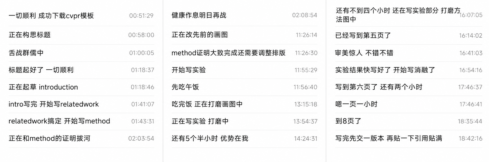

# 20h Miracle Skill

**源于一次距离 CVPR 截稿不到 20 小时、通过对话从零完成论文写作的经历，将其中的写作经验与偏好整理为可复用的学术写作 skill。**

*Born from completing the writing of a CVPR paper from scratch through conversation with less than 20 hours before the deadline—a reusable academic writing skill built from that writing experience and the preferences developed along the way.*

[中文](#中文) · [English](#english)

## 中文

### 起源

惊觉距离 CVPR 截稿已不到 20 小时，我决定从头开始写论文。这次没有采用 vibe writing，而是回归“半古法科研写作”：在对话框里，一轮轮讨论、逐段完成。最后，我在晚上 7 点写完全文，距离截稿还有大约 1 小时——中间甚至正常睡了 7 小时，并没有熬夜。

出乎意料的是，这次的写作体验比以往的 vibe writing 还要好。于是，我决定开始维护这份 skill 文档，把对话中逐渐形成的写作习惯、表达偏好和修改原则沉淀下来，延续这种写作方式。

我把这次对话过程中不断补充的要求和规范整理了出来，去掉仅适用于 CVPR 或我个人研究内容的细节，保留其中具有通用性的部分，形成了这份写作规范。



### 关于写作

*遗憾的是，在不少人沉浸于 auto research 和 vibe writing 的同时，一些生成的内容连作者自己都难以读懂：图表带着浓重的 AI 痕迹，缺乏可读性；文字晦涩，夹杂大量数字、代码和符号，读起来更像训练日志。*

这个 skill 依然需要作者对一篇好的论文是什么样的有基础的概念才可以用好，写作依然是需要反映作者思考和价值的部分。

这个 skill 会随着我的实际使用和收到的反馈持续更新、维护。

### 如何使用

比起在 Codex、Claude Code 等 agent harness 中使用，我更推荐在一个记忆较长、幻觉较少的对话框中使用本 skill 的 [chat prompt](prompts/chat-web.md)，然后手动将写作结果粘贴到 Overleaf。这样不仅能提高作者对写作内容的可控性，也能帮助作者清楚地了解自己的论文究竟写了什么。

| 入口 | 使用方式 |
| --- | --- |
| Codex | 已安装后使用 `$miracle-skill`，附上论文材料和本次任务；也可直接使用 [Codex 提示词](prompts/codex.md)。 |
| Claude Code | 指定本仓库 `SKILL.md` 的实际路径，要求读取并执行；或复制 [Claude Code 提示词](prompts/claude-code.md)。 |
| 聊天网页端 | 复制 [网页端完整提示词](prompts/chat-web.md)，填写末尾任务并粘贴或上传论文材料。 |

三端提示词包含同一份完整写作规范。Agent 入口通过 `SKILL.md` 读取详细规范；网页端版本可独立使用，无需读取本地文件。

### 文件结构

```text
20h-miracle-skill/
├── SKILL.md                         # 技能入口
├── references/
│   ├── original-sanitized.md         # 完整详细规范
│   ├── sections.md                  # 章节速查
│   ├── evidence.md                  # 证据与引用速查
│   └── layout.md                    # 排版速查
├── prompts/
│   ├── codex.md
│   ├── claude-code.md
│   └── chat-web.md
├── agents/openai.yaml               # 技能显示配置
└── scripts/build_prompts.py         # 生成三端完整提示词
```

### 友情链接

[WritingAIPaper](https://github.com/hzwer/WritingAIPaper) — 本项目受到它的部分启发，推荐搭配使用，效果更佳。

## English

### The story

With less than 20 hours left before the CVPR deadline, I decided to write the paper from scratch. This time, I skipped vibe writing and took a semi-old-school approach: working through the paper in a chat window, one conversation and one section at a time. I finished the full draft at 7 p.m., with about an hour to spare—and still managed to get seven hours of sleep along the way. No all-nighter required.

To my surprise, the experience was better than my previous attempts at vibe writing. That inspired me to start maintaining this skill document: a collection of the writing habits, stylistic preferences, and revision principles that emerged from those conversations, so I could keep writing this way.

I collected the requirements and guidelines I kept adding throughout those conversations, removed details specific to CVPR or my own research, and distilled the broadly applicable parts into this set of writing guidelines.

### On writing

*Unfortunately, as more people immerse themselves in auto research and vibe writing, some of the resulting papers are difficult even for their own authors to understand. Figures and tables have an unmistakably AI-generated look and are hard to read; the prose is opaque, cluttered with numbers, code, and symbols, and reads more like training logs.*

Using this skill well still requires the author to have a basic sense of what a good paper looks like. Writing remains a part of the process that needs to reflect the author's thinking and the value they bring.

I will continue to update and maintain this skill through my own use and the feedback I receive.

### Usage

Rather than using this skill in agent harnesses such as Codex or Claude Code, I recommend using its [chat prompt](prompts/chat-web.md) in a chat that retains context over longer conversations and is less prone to hallucinations, then manually pasting the writing into Overleaf. This gives authors more control over the content and helps them understand exactly what their paper says.

| Environment | How to use it |
| --- | --- |
| Codex | Once installed, invoke `$miracle-skill` with your materials and task, or use the [Codex prompt](prompts/codex.md) directly. |
| Claude Code | Ask the agent to read and follow this repository’s `SKILL.md` using its actual local path, or paste the [Claude Code prompt](prompts/claude-code.md). |
| Browser chat | Paste the [complete web prompt](prompts/chat-web.md), fill in the task at the end, and paste or upload your paper materials. |

All three prompts contain the same complete writing guidelines. The skill entry point loads the detailed reference; the browser prompt works independently of local files. The current guidelines and prompts are written primarily in Chinese, with English writing examples.

### Related project

[WritingAIPaper](https://github.com/hzwer/WritingAIPaper) — This project was partly inspired by WritingAIPaper. I recommend using the two together for a better writing experience.
